<p align="center">
  <picture>
    <source media="(prefers-color-scheme: dark)" srcset="docs/assets/mark-dark.svg">
    
  </picture>
</p>

<h1 align="center">LoopTitan</h1>

<p align="center">
  <strong>A common ground for looped MoE research.</strong><br>
  The design space of looped MoE in one model, compared on equal terms.
</p>

<p align="center">
  <a href="#documentation">Documentation</a> &nbsp;·&nbsp;
  <a href="docs/results/phase1.md">Results</a> &nbsp;·&nbsp;
  <a href="https://github.com/datamllab/LoopTitan/issues">Record</a>
</p>

<p align="center">
  <picture>
    <source media="(prefers-color-scheme: dark)" srcset="docs/assets/hero-dark.svg">
    
  </picture>
</p>

## At a glance

### One model, every design.

Where the loop sits, how often it runs, what each visit shares, how the residual is scaled, how the input re-enters and how depth is chosen are fields of one readable PyTorch model. Each configuration declares its parent and the fields it changes ([lineage](#designs)).

### Equal budgets before you train.

Unique parameters, training FLOPs and KV cache come from the configuration, on a CPU, in one command. Two configurations are matched when all three are within 5% ([cost contract](docs/comparison.md)).

### Checked against independent code.

The model matches the official Transformers Qwen3-MoE in logits, gradients, optimizer steps and cache ([check](docs/baselines.md)). Two published looped checkpoints convert with the same logits ([#199](https://github.com/datamllab/LoopTitan/issues/199), [#201](https://github.com/datamllab/LoopTitan/issues/201)).

## Quick start

Install from source (Python 3.12, Torch 2.14.0):

```sh
uv venv --python 3.12
. .venv/bin/activate
uv pip install 'torch==2.14.0' --index-url https://download.pytorch.org/whl/cpu
uv pip install '.[data,hf]'
```

Compare the loop of [Phase 1](#studies-run-on-looptitan) with its untied twin, which owns separate weights for each visit. The command prints one JSON record; its `matched` section, shown here, holds the three budgets:

```console
$ python scripts/compare_recipes.py compare \
    recipes/phase1/m3-adamw.json recipes/phase1/m4-adamw.json --seq-len 4096
  "matched": {
    "logical_kv_bytes": {
      "basis": "analytical_estimate",
      "candidate": 25952256,
      "reference": 25952256,
      "relative_difference": 0.0,
      "relative_tolerance": 0.05
    },
    "training_flops_per_token": {
      "basis": "analytical_estimate",
      "candidate": 3213955008,
      "reference": 3217300416,
      "relative_difference": -0.0010398183468857637,
      "relative_tolerance": 0.05
    },
    "unique_non_embedding_parameters": {
      "basis": "analytical_estimate",
      "candidate": 1329281184,
      "reference": 1314771744,
      "relative_difference": 0.01103571024112304,
      "relative_tolerance": 0.05
    }
  },
```

Build a looped model, run it and cost it:

```python
import torch
from moeloop import LoopedLM, ModelConfig
from moeloop.costs import estimate_cost

# one outer layer, two middle layers that run twice, one outer layer;
# the middle layers share their weights across visits, attention excepted
config = ModelConfig(vocab_size=128, dim=32, hidden_dim=64, num_heads=4, num_kv_heads=2,
                     num_experts=4, top_k=2, prefix_cells=1, num_cells=2, suffix_cells=1,
                     num_visits=2, attention_per_visit=True, max_seq_len=64)
model = LoopedLM(config).eval()
with torch.no_grad():
    logits = model(torch.randint(0, 128, (2, 16))).logits
print(tuple(logits.shape))                 # (2, 16, 128)

cost = estimate_cost(config, seq_len=16)
print(cost["calls"]["forward_cells"])      # 6
print(cost["parameters"]["unique_non_embedding"],
      cost["flops"]["training_per_token"],
      cost["kv"]["bytes_at_context"])      # 117536 619008 6144
```

## Designs

A looped MoE is an ordinary MoE with a few decisions changed. Each decision is a field of [`ModelConfig`](src/moeloop/config.py) or of the training recipe.

| Mechanism | Field | Designs |
|:---|:---|:---|
| Where the loop sits and how often it runs | `prefix_cells`, `num_cells`, `suffix_cells`, `num_visits` | [\[1–⁠4,&nbsp;6–⁠10\]](#references) |
| Experts per region | `prefix`, `core`, `suffix` (`num_experts`, `hidden_dim`, `top_k`) | [\[1,&nbsp;4\]](#references) |
| What a visit shares | `attention_per_visit`, `router_per_visit`, `norm_per_visit` | [\[4,&nbsp;8\]](#references) |
| Residual scale, global or per visit | `core.residual_scale`, `visit_residual_scales` | [\[1,&nbsp;2\]](#references) |
| Input re-entry | `input_injection` | [\[6,&nbsp;7\]](#references) |
| Initial state and state update | `initial_state`, `state_update` | [\[6–⁠8\]](#references) |
| Depth: fixed, sampled or learned | `depth_rule`, `grad_visits`, `exit_distribution` | [\[6,&nbsp;9\]](#references) |
| Low-rank delta per visit | `lora_attention_rank`, `lora_ffn_rank` | [\[10\]](#references) |
| Experts tied across layers | `order="layer"` with attention, router and norms per visit | [\[5\]](#references) |

A reference number marks a published design that uses the mechanism and is implemented here. Each frozen configuration names its parent and the fields it changes. An excerpt of the one-change chain, in the real order (a line `…` stands for lines left out, and `…` in brackets for fields left out):

```console
$ python scripts/lineage.py
phase1/m0
  …
  phase1/m3  [dim, hidden_dim, num_heads, num_experts, …, num_visits, core]
    phase1/m4  [num_cells, num_visits, core]
      phase1/m4-elr
      shape/u  [prefix_cells, num_cells, suffix_cells, num_experts, core]
      shape/r  [core]
  …
```

The command prints the whole tree. Each configuration in plain words: [Phase 1 results](docs/results/phase1.md); what each keeps from its source and what it adapts: [method map](docs/method-map.md).

## Compare

`compare` writes one record that sorts each quantity into matched, controlled, measured-different or unknown, and allocates no GPU. The controls of a study ship as configurations: the untied twin of the quick start and the one-change chain of [Phase 1](#studies-run-on-looptitan). [`scripts/recipe_atlas.py`](scripts/recipe_atlas.py) sweeps the shapes of a configuration and marks those that match a reference on all three budgets. Definitions and the CLI: [cost and comparison](docs/comparison.md#cli-and-plain-json).

## Check

Evidence: [method](docs/baselines.md), [CPU record](docs/evidence/qwen3-cpu.json), [reference tests](tests/reference), [conversion tests](tests/hf). The conformance check tests a configuration against the model's own contracts (parameter ownership, shared gradients, cost-model calls, cache, export round trip, identity) on a CPU in seconds ([details](docs/development.md#conformance-tests-and-diagnostics)):

```python
from moeloop.recipe_spec import RecipeSpec, TrainingRecipe
from moeloop.testing import check_recipe

spec = RecipeSpec(name="my-loop", model=config, training=TrainingRecipe(num_visits=2))
report = check_recipe(spec)  # raises ConformanceError if a check fails
print({name: check["status"] for name, check in report["checks"].items()})
# {'ownership': 'pass', 'shared_gradients': 'pass', 'cost_calls': 'pass',
#  'cache': 'pass', 'hf_roundtrip': 'pass', 'identity': 'pass'}
```

Here `config` is the model of the quick start.

## Train and export

Training runs on [TorchTitan](https://github.com/pytorch/torchtitan) with AdamW or Muon. Initial weights, data order and validation samples do not depend on the GPU count ([architecture](docs/architecture.md#7-data-resume-and-export-are-the-product-core), [#175](https://github.com/datamllab/LoopTitan/issues/175)). Resume is bit-exact in model and optimizer state ([validation](docs/validation.md#distributed-training-full-state-resume-and-model-delivery)). Export writes a standalone Hugging Face model ([export](docs/training.md#export-evaluate-and-generate)).

Training needs a CUDA build of Torch 2.14.0 and the `train` extra ([setup](docs/training.md#set-up-the-environment)):

```sh
python scripts/recipe_experiments.py run --spec recipes/phase1/m3-muon.json \
  --manifest "$MOELOOP_DATA/manifest.json" --output runs/m3-muon --gpus 8 --evaluate
```

The command trains the Phase 1 loop with Muon, exports the final checkpoint to `runs/m3-muon/hf` and measures BPB on the full validation and test splits. Data preparation, resume and generation: [Training and data](docs/training.md).

## Studies run on LoopTitan

### Phase 1: where the gain of a looped MoE comes from

The study walks one change at a time from an ordinary MoE to a looped MoE, at equal budgets, under two optimizers.

| Step | Configuration | AdamW | Δ | Muon | Δ |
|:---|:---|---:|---:|---:|---:|
| 0 | [Ordinary MoE](recipes/phase1/m0-adamw.json): 12 layers of 64 experts | 0.9995 | | 0.9744 | |
| 1 | [Finer experts](recipes/shape/g-adamw.json): 72 smaller experts, top-9 | 0.9953 | −4.2 | 0.9735 | −0.9 |
| 2 | [Deeper and narrower](recipes/shape/u-adamw.json): 18 layers at width 1056 | 0.9926 | −6.9 | 0.9702 | −4.2 |
| 3 | [Expert layout](recipes/shape/r-adamw.json): 88 experts in the 6 outer layers, 44 in the 12 middle | 0.9936 | −5.9 | 0.9710 | −3.4 |
| 4 | [Residual scale](recipes/phase1/m4-adamw.json): middle residual ×0.5 | 0.9906 | −8.9 | 0.9710 | −3.3 |
| 5 | [The loop](recipes/phase1/m3-adamw.json): the 12 middle layers become 6 layers of 88 experts, run twice | 0.9905 | −9.0 | 0.9707 | −3.7 |

Test bits per byte (BPB) after 5.0B tokens of DCLM (4,769 updates of 1,048,576 tokens, seed 42); lower is better. Δ is the difference to step 0 with the same optimizer, in mBPB; a negative Δ is a gain. Parameters, training FLOPs and KV cache of every step are within 5% of step 0. Learning rate: tuned once per optimizer on the ordinary MoE (AdamW 1.2e-3, Muon 1.7e-3); the loop of step 5 selects the same value under the same grid; every other configuration inherits it.

1. **The loop itself adds almost nothing.** At equal budgets the loop is level with its untied twin (step 5 against step 4); most of the gain comes from shape.
2. **More than half of the gain disappears under Muon.** The whole chain gains 9.0 mBPB under AdamW and 3.7 under Muon.
3. **Beyond equal budgets, one more visit gains as much as twice the experts under Muon.** The visit costs 31% more training FLOPs and no new weights ([outside matched budgets](docs/results/phase1.md#outside-matched-budgets)).

Every configuration, the controls and both optimizers: [Phase 1 results](docs/results/phase1.md) ([data](docs/results/phase1.json)). The record of the study: [#177](https://github.com/datamllab/LoopTitan/issues/177), [#216](https://github.com/datamllab/LoopTitan/issues/216), [#225](https://github.com/datamllab/LoopTitan/issues/225).

Later phases join this list when they are released.

## An open record

Each study is an issue that declares its arms, controlled settings and budget before the runs ([#225](https://github.com/datamllab/LoopTitan/issues/225)). [`scripts/results.py`](scripts/results.py) checks the runs of a study against its declared design ([#232](https://github.com/datamllab/LoopTitan/issues/232)). Failed runs and short checks stay in the record ([#243](https://github.com/datamllab/LoopTitan/issues/243), [protocol](docs/protocol.md#state-and-decisions)). The [issues](https://github.com/datamllab/LoopTitan/issues) are a copy of the development record under the original issue numbers, with pull-request records among them ([#199](https://github.com/datamllab/LoopTitan/issues/199)).

The benchmark is a frozen protocol of four tracks ([`eval/bench/tracks.json`](eval/bench/tracks.json)). A checker binds a submission folder to its files and lists what it cannot check ([benchmark](docs/comparison.md#benchmark-submission-folder)). It does not yet accept outside entries.

## Add a configuration

A new configuration is a recipe: change the fields of an existing one, cost it, run the conformance check and find its place in the lineage. [Extensions](docs/extensions.md#add-a-configuration) walks through the four steps, and through a new forward pass.

## Documentation

| Document | Contents |
|:---|:---|
| [Architecture](docs/architecture.md) | Physical layers and logical calls, the model, training, data, resume and export |
| [Recipes](docs/recipes.md) | The configurations of the published designs and where to start reading |
| [Method map](docs/method-map.md) | Each design: its source, what is kept and what is adapted |
| [Extensions](docs/extensions.md) | A new configuration, a new state update, a new attention |
| [Cost and comparison](docs/comparison.md) | Budgets, the comparison record and the benchmark |
| [Training and data](docs/training.md) | Data preparation, training, resume, export and evaluation |
| [Independent check](docs/baselines.md) | The check against Transformers Qwen3-MoE |
| [Validation](docs/validation.md) | What was run on GPU, and the limits of each result |
| [Development](docs/development.md) | Tests, conformance and diagnostics |
| [Protocol](docs/protocol.md), [TorchTitan record](docs/torchtitan.md) | How studies and runs are recorded |
| [Phase 1 results](docs/results/phase1.md) | Every Phase 1 configuration under one protocol |

Tests: `uv sync --frozen && uv run --frozen python -m pytest -q`. The model tests need Torch and the `train` extra ([Development](docs/development.md#development-environment-and-checks)).

## Acknowledgements

LoopTitan builds on the work of many people. We thank them.

- [TorchTitan](https://github.com/pytorch/torchtitan), the trainer every run uses.
- [CVSM](https://github.com/doem97/cvsm), the protocol and run tooling this repository adopts.
- [Hugging Face Transformers](https://github.com/huggingface/transformers), whose Qwen3-MoE implementation the model is checked against, and the released checkpoints and model code of [ByteDance/Ouro-1.4B](https://huggingface.co/ByteDance/Ouro-1.4B) and [tomg-group-umd/huginn-0125](https://huggingface.co/tomg-group-umd/huginn-0125), the references for checkpoint conversion.
- The public code of the looped designs implemented here: [seal-rg/recurrent-pretraining](https://github.com/seal-rg/recurrent-pretraining)<sup>[6](#references)</sup>, [SR-A-W/how-to-loop-moe](https://github.com/SR-A-W/how-to-loop-moe)<sup>[4](#references)</sup>, [epfml/looped-moe](https://github.com/epfml/looped-moe)<sup>[5](#references)</sup>, [hed-ucas/LOOM](https://github.com/hed-ucas/LOOM)<sup>[8](#references)</sup>, [ifm-ai/xllm-loop](https://github.com/ifm-ai/xllm-loop)<sup>[7](#references)</sup> and [lcqysl/LatentLoop](https://github.com/lcqysl/LatentLoop)<sup>[2](#references)</sup>.
- [DCLM](https://huggingface.co/datasets/mlfoundations/dclm-baseline-1.0), the open corpus the Phase 1 study trains on.

## References

1. SMELT: Scaling Laws for Compute-Matched MoE Looped Transformers. 2026. [arXiv:2609.01343](https://arxiv.org/abs/2609.01343)
2. LatentLoop: Scaling Looped MoE Models with Asymmetric Compute Allocation. 2026. [arXiv:2610.19975](https://arxiv.org/abs/2610.19975)
3. Scaling Laws for Looped Mixture of Experts. 2026. [arXiv:2609.40316](https://arxiv.org/abs/2609.40316)
4. How to Loop MoE: Flatten the Experts, Untie the Attention. 2026. [arXiv:2609.35751](https://arxiv.org/abs/2609.35751)
5. Tying the Loop – Tied Expert Layers in Mixture-of-Experts Language Models. 2026. [arXiv:2606.16825](https://arxiv.org/abs/2606.16825)
6. Scaling up Test-Time Compute with Latent Reasoning: A Recurrent Depth Approach. NeurIPS 2025. [arXiv:2502.05171](https://arxiv.org/abs/2502.05171)
7. Towards Looped Models Done Right, Part I: Topology, Input Injection, Recurrent-State Design. 2026. [arXiv:2610.23036](https://arxiv.org/abs/2610.23036)
8. Looping Beyond Twice: A Scalable Recipe for Looped Mixture-of-Experts. 2026. [arXiv:2610.01153](https://arxiv.org/abs/2610.01153)
9. Scaling Latent Reasoning via Looped Language Models. 2025. [arXiv:2510.25741](https://arxiv.org/abs/2510.25741)
10. Relaxed Recursive Transformers: Effective Parameter Sharing with Layer-wise LoRA. ICLR 2025. [arXiv:2410.20672](https://arxiv.org/abs/2410.20672)

## Citation

Cite the repository and the exact source commit: [CITATION.cff](CITATION.cff). Cite the papers of the designs you use separately; the [method map](docs/method-map.md) lists them.

## Licence

[MIT](LICENSE). Copyright the LoopTitan authors.
